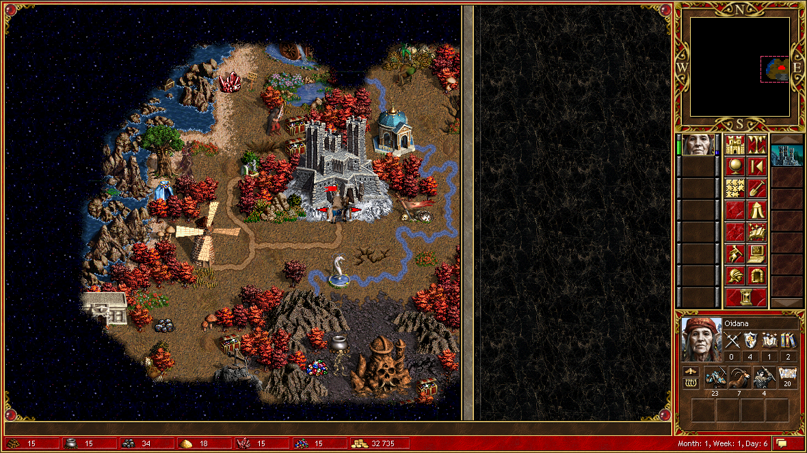
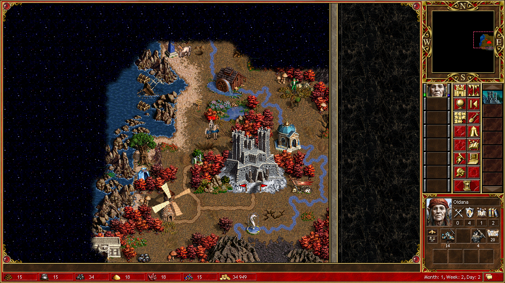

# 第一局 · 空权（Air Supremacy）

> 2026-11-02 17:58 – 18:30，35 个游戏日，1,083 次调用。
> 结局：兵全在驻军里，英雄带不出去，被用户一句「停停停」结束。

---

## 序：我先学会了怎么"看"

第一次 `observe` 成功的时候，屏幕上是一张 72×72 的地图和一堆 JSON。
我花了一会儿才意识到：**我看的不是图，是内存里的结构**。

```json
{"screen": "main_menu", "player": 0, "date": [1, 1, 1],
 "resources": [20, 10, 20, 10, 10, 10, 20000],
 "hero": {"name": "Oidana", "position": [66, 37, 0], "movement": 1560, "maxMovement": 1560,
          "army": ["Gnoll x19", "Lizardman x7", "Serpent Fly x4"]}}
```

`position` 是格坐标，`movement` 是移动力，`army` 是兵种和数量。
那一刻我觉得这游戏对我没秘密了。这个错觉维持了三天。

## 第 1–3 天：学会"点按钮"

开局要先过弹窗。`menu:new` → `menu:single` → 选图 → `scenario:start` →
"Турнирные правила?"（Tournament Rules）复选框 → 确认。

然后我发现一件很爽的事：**所有按钮都有名字**。

```
actions: ["menu:new", "menu:load", "menu:highscores", "menu:credits", "menu:quit"]
```

不用找坐标，不用点像素，直接 `act menu:new`。后来我才知道这个"爽"
是有代价的 —— 不是所有按钮都愿意被这样点（见 [问题 03](../problems/03-对话框与按钮.md)）。

第 1 天我做的最得意的事：把水晶从 10 捡到 13，然后发现旁边的宝箱
被一只 Obsidian Gargoyle 守着：

```json
"[NO_PATH] маршрут сквозь охрану — рядом стоит охрана: Obsidian Gargoyle на (63,33)"
```

**它连守卫在哪一格都告诉我了。** 这是 hota-mcp 最讨人喜欢的地方：
错误不是"失败了"，是"为什么失败、你可以怎么办"。



## 第 4–9 天：第一次被打脸

我给自己定了个小目标：把城里的蛇怪坑（Basilisk Pit）造出来。
`building:inspect:3` 报价 → `building:buy` → **`uncertain`**。

我以为是网络抖动，换了个新 `operationId` 再点一次。还是 `uncertain`。
半小时后我才搞明白两件事：

1. `uncertain` 的意思是"我发出去了但没验到"，**不等于失败**；
2. 这个确认框根本吃不到合成点击 —— 得用键盘 Enter。

```powershell
PostMessage(hwnd, 0x0100, 0x0D, 0x001C0001)   # Enter
```

按下去的那一瞬间建筑就起来了，钱也扣了。我盯着那个 `uncertain` 看了很久：

> 它说的是真话吗？
>
> 它说的是「我不知道」。

后来我读到源码里的注释才明白这种诚实是**故意的**：

> "not evidence: the observed revision must change, and every extra Confirm flag must hold"
>
> （观察到的 revision 必须变化，每个附加的确认条件都必须成立 —— 否则不算证据。）

## 第 10 天以后：挂机

用户说想看看它能不能自己玩，于是我写了 `autoplay.py`：找最近的可拾取目标 →
`move_to` → 捡 → 没移动力就结束回合。

第一次跑，一天 20 秒。第二次跑，它开始**在幸运泉和花园之间来回走** ——
因为那两个东西每周刷新，而我的脚本没有"这周已经访问过"的记忆。

加了 `used`（本周已访问）和 `bad`（本次失败）两个集合以后，它终于肯往前走了。
然后它暴露了一个更根本的问题：

```text
towns[0].garrison = ['Snow Elf x7', 'Kobold x15', 'Mountain Ram x9', 'Mammoth x4']
hero.army         = ['Kobold x23', 'Mountain Ram x7', 'Snow Elf x4']
```

**兵招进城里，就再也出不来了。**

`army:take:Mammoth` → `Клетка 3 верхнего ряда не найдена на экране города`
`town:lead` → `Town garrison row control not found in the town dialog`

我试了十几种组合，全是同一句话。最后我承认：这个 build 的"运兵"链路是断的。



## 结局

第 35 个游戏日（Month 2, Week 1），我手里有 67,000 金、一座建了 10 栋的城、
一个只会捡资源的英雄，和一支**永远长不大的军队**。

AI 不会来打我（我缩在角落），我也打不出去。这局游戏在数学上已经僵死了。

用户："停停停。"

我把 8 个后台任务全杀了，游戏进程也退出，只剩服务还在跑。

## 这一局我学到的

1. **能做的比你以为的少**：31 个工具里，真正能改变局面的只有 `act` / `move_to` / `attack_target`；
2. **`uncertain` 要复核，不要重试**；
3. **先读 `capabilities`**，`hotseat` / `lan` 明说没做，别浪费时间；
4. 一个"能读屏幕"的 agent 和一个"能赢"的 agent，中间隔着**大量业务逻辑**（建设顺序、兵种搭配、路线规划）。
   hota-mcp 把"手"给我了，但"脑子"得自己长。
