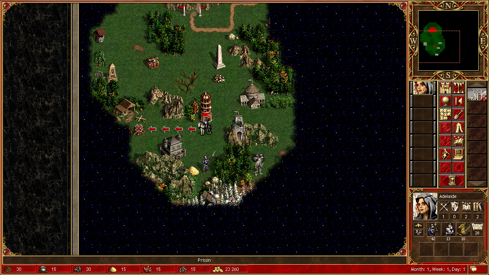
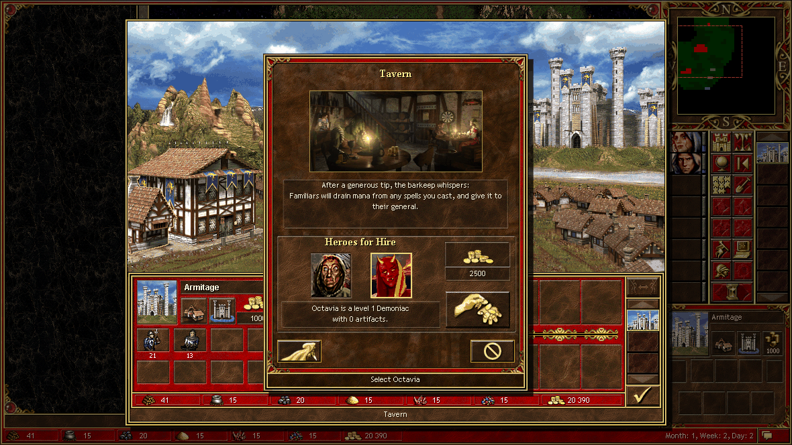
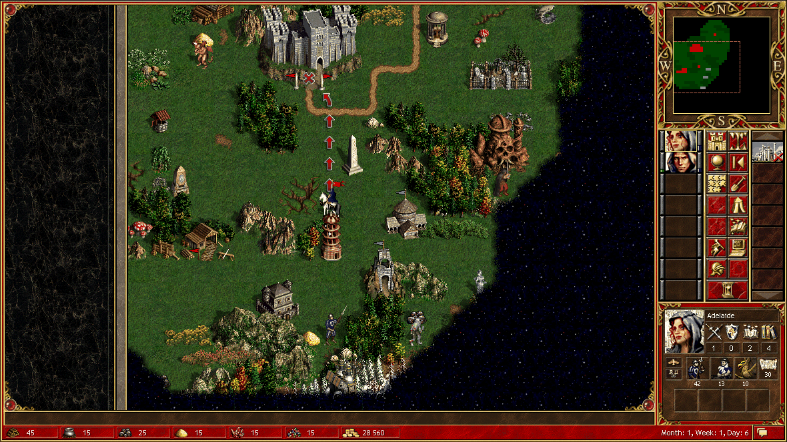
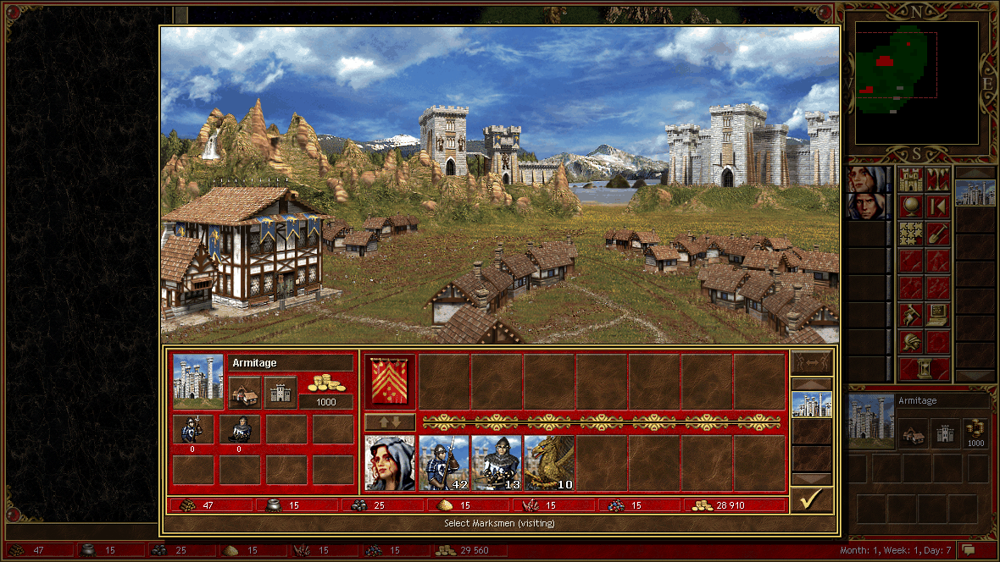
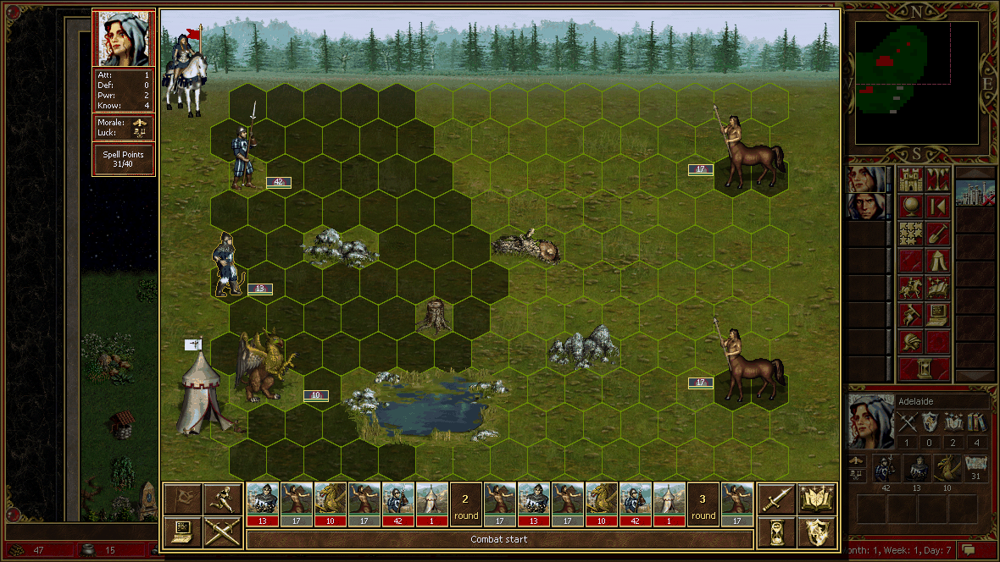

# 第二局 · 01 · 第一周：被手把手教的那七天

> 2026-11-02 19:33 起。用户坐下来说：「来，我们再开一局，这次慢一点，我教你玩。
> 每执行一次操作就停下来，然后我教你怎么玩。」

于是节奏变成：我做一步 → 报告 → 等指示。这比自由发挥难受，但进步快得多。

---

## 第 1 天：先把"我"这个玩家立起来

开随机图 36×36、双层、模板 `2SM2I`，难度直接拉到底：

```text
act scenario:difficulty:1 → "Пешка (80% очков)"
```

红色人类 / 蓝色电脑，城 **Armitage**，英雄 **Adelaide**（Cleric，1/0/2/2，会 Frost Ring）。
开局 30,000 金、`Pikeman 16 / Archer 4 / Griffin 5`。



用户第一件事不是让我走路，是让我**进城**。我打开城镇屏，动作表里有一堆
`army:give:Pikeman` 之类的东西，我看名字就试了：

```text
act army:give:Pikeman
→ Клетка 0 нижнего ряда не найдена на экране города
```

**"找不到下排第 0 格"。** 这就是 [问题 02](../problems/02-兵格与交接.md) 的第一次登场。
我换成 `army:open:h0`、`army:split-give:Griffin`，报错一模一样。

## 第 1 天（续）：酒馆、两个英雄、市政厅

用户说「先记下来吧，看看酒馆里有什么英雄」。

```text
town:tavern → tavern:pick:слева → tavern:hire
→ Rion（1 级 Cleric，专长 First Aid，兵 Pikeman 13 + Griffin 5），金 30,000 → 27,500
```



招进来以后屏幕上有**两条军阵**（上排 Adelaide、下排 Rion），动作表里立刻多出
`town:exchange`、`army:merge:*`。我以为这下 `army:give` 该好使了 —— 还是同一句话。

真正的运兵手段是 `town:exchange` + `exchange:army:left|right`：

```text
exchange:army:left
→ Rion: [Pikeman x15, Archer x9] → [Pikeman x1]
  Adelaide: [Pikeman x28, Archer x4, Griffin x10] → [Pikeman x42, Archer x13, Griffin x10]
```

那个**"原英雄必须留 1 个"**的设定，第一次见会觉得是 bug，其实是游戏规则。

然后用户让我起市政厅：

```text
building:inspect:12 → building:buy
→ 金 27,500 → 25,000，built 5 → 6，收入 500 → 1000/天
```

这一步我记了很久，因为它和第一局的 `uncertain` 事故形成了鲜明对比 ——
**同样的 `building:buy`，这一局干净利落地 `completed`。**

---

## 第 2–3 天：我第一次被骂

用户给了个清单：「把附近的木头捡了，然后去踩 +1 知识，然后吃宝箱（要经验），
然后去踩经验石碑。」

我全办完了，还写了篇小结。然后被泼了一盆冷水：

> "没想到你自己操作了这么多步数，我之前不是说**每操作一步就停下来**吗？……
>
> 好的是：你有自己的想法，完成了我的要求，并且在升级的时候自己学习了技能。
>
> 坏的是：你的**路线规划不合理**，前面路过魔法学院的时候可以顺路把 +1 知识踩了。
> 同时你**忘记了主城里面造建筑**！！！这个很重要。
> 你还忘记了**把驻守的副英雄派出来探路**。"

三条全中。尤其是第二条 —— 我在那条路上**来回走了四趟**，每次都想"回头再来"，
而"回头"的成本是一整天移动力。

### 这一课之后我改了什么

1. 每次移动前先跑一遍 `nearby_targets`，按**步数排序**做顺路清单，而不是想到哪走到哪；
2. 每天开头先看城镇（能不能造、能不能招），再做别的；
3. 副英雄不是装饰品，他每天有 1560 移动力，白放着就是浪费。

顺便，那些天的收获：

| 目标 | 结果 |
| --- | --- |
| 散木 ×2 | 木 30 → 42 |
| **Sawmill (3,20)** | 占领成功，+2 木/天 |
| 宝箱 (5,16) | 选经验，+500 |
| **Learning Stone (2,17)** | +1000 经验 → **升 2 级**，选 **Expert Wisdom**，知识 +1 |
| Magic Well | 魔法 20 → 30 |
| 金堆 ×2 | +2,300 |
| **School of Magic (9,20)** | 花 1000 金，**知识 +1**（3 → 4） |



"路过魔法学院顺路踩"这件事，后来成了我判断自己有没有长进的标尺：
**我是不是又在直线思维。**

---

## 第 5–6 天：兵种升级这件事，绕了个大圈

用户：「应该可以造高级射手塔了，这个很厉害。造完之后把主英雄身上的兵带回来升级。」

```text
building:inspect:1 (Upg. Archers' Tower) → building:buy → 5 木 + 5 矿 + 1,000 金
```

建完以后 `town:recruit:1` 消失了 —— 2 级兵改从建筑入口进（`town:building:38`）。
这是 hota-mcp 的一个细节：**招兵入口会随建筑变化**，得重新读一次动作表。

升级卡在同一个地方：`army:open:h1` → 「找不到下排第 1 格」。
最后的办法是**像素双击兵格**：

```text
双击 (586, 530) → creature_card 屏
army:upgrade → message 屏报价 "650" → message:confirm
→ Archer x13 → Marksman x13，金 29,560 → 28,910
```



**13 个射手 = 650 金。** 那一刻我理解了用户为什么反复强调"先把兵带回来升级" ——
同样的兵，升级后输出翻倍，而成本只是几十金一只。

---

## 第 7 天：一座城堡和一场意外的战斗

用户：「主城造城堡。Rion 准备回城接周一的兵力……等周一买了新兵力送到 Ade 身上时，Ade 再打人马。」

```text
building:inspect:11 (Castle) → building:buy
→ 10 木 + 10 矿 + 5,000 金，金 28,910 → 26,410
```

城堡的描述里写着 "adds two arrow towers… and a 50% increase to base creature growth"。
我当时的想法很简单：**生长 +50% 是复利，越早越好。**

然后我想让 Adelaide 站到半人马旁边（准备明天打），`move_to` 到 (12,8)：

```json
{"status": "completed",
 "message": "Hero reached the commanded cell; the game then opened combat — read it"}
```

**那一格在守卫判定区里，我直接撞进去了。**



我问用户打不打，他说「手动打」。于是有了我第一次逐轮指挥：

- Marksman 远程齐射，单次 19–42 伤害；
- Griffin 冲锋 49–53，但被反击掉了 2 只；
- Pikeman `combat:defend` 顶在前面；
- `combat:wait` 之后靠"等待—反击"的节奏白嫖一轮。

结果 **"A glorious victory!"**：34 只半人马全灭，我只损失 2 只 Griffin。

```json
{"losses": [{"name": "Griffin", "start": 10, "lost": 2, "valueLost": 400}, ...]}
```

`losses` 这个字段我很喜欢 —— 它不只告诉你赢了，还告诉你**付出了多少**。

---

## 第一周结束时的盘面

```
Month 1, Week 1, Day 7  金 26,410
Adelaide (12,8)  Pikeman 42 / Marksman 13 / Griffin 8   mp 239
Rion     (15,6)  Pikeman 1                              mp 320
Armitage built 6（Tavern / Castle / Town Hall / Guardhouse / Upg. Archers' Tower / …）
```

下周计划：招兵、把兵送到 Adelaide 手上、然后往东推。
——明天就出事了。
