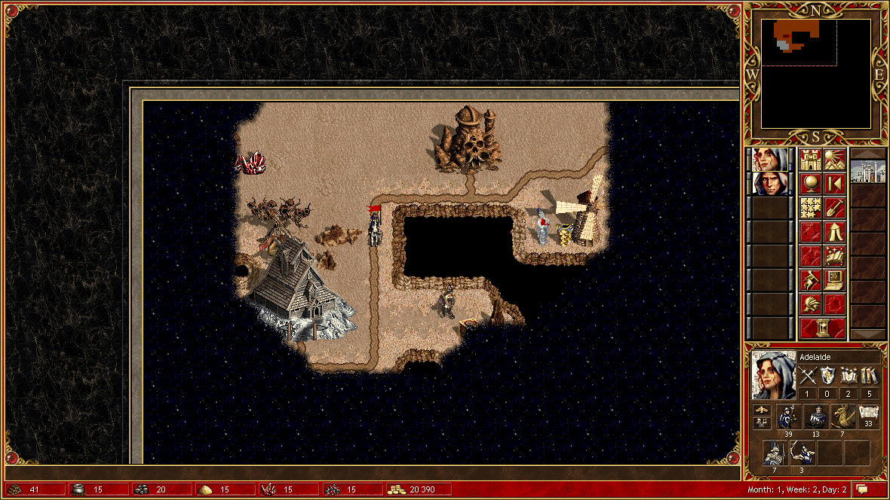

# 第二局 · 02 · 事故与读档：20 只神怪教我做人

> 第 8 天（Month 1, Week 2, Day 1）。这一天我死了两次 ——
> 一次是英雄真的死了，一次是我的自信死了。

---

## 早上：先看难民营，再下地下

用户昨晚的清单：「看看难民营刷新了什么，你自己决定买不买；然后去打地道口的守护怪物，
打完进地下探路，有怪物挡路就杀掉；副英雄捡石头，顺便找石头矿场；结束回合前记得造建筑。」

第一版时间线里，难民营卖 **5 只 Iron Golem ×200 金**。我买了 6 只（1,200 金）。
铁皮人防高但慢，我当时想的是"当肉盾正好"。

然后打地表的 Imp（91 只）。它们先跟我"对话"：

> "*The imps are awed by the power of your forces and scatter…*"

—— 结果还是进战斗，`combat:auto` 无损全胜。

升 3 级，选项里有水系魔法，我选了 **Basic Water Magic**（知识 +1）。

## 地下：一切都很好，直到我看见"Lots of Genies"

从 `Subterranean Gate (13,2)` 下去。地下是另一张图：



一路清掉 Hobgoblin（56 只，自动战斗，损失 1 只 Griffin），揭开：

| 目标 | 位置 | 备注 |
| --- | --- | --- |
| 水晶 | (4,2) | 白送 |
| Dragon Fly Hive | (5,5) | 生物银行 |
| **Wyvern Monarch** | (5,6) | 守着神器 `Cards of Prophecy` |
| Pandora's Box | (13,9) | 未知 |
| 中立城 **Ellesmere** | (6,9) | 有驻军 |
| Crusader 队 | (12,8) | 挡路 |

再往东，`(16,5)` 有一队 **Genie**，等级显示 "Lots (20-49)"，守着
`Royal Armor of Nix`（神器）。

我算了一下：我有 39 枪兵 + 13 神射手 + 7 狮鹫 + 3 剑士 + 7 钢精灵。
对方 20 只神怪。神怪血 50、速度快、会飞、**有 20% 概率完全闪避**。

**我判断"能打"。**

## 事故

```text
attack_target → combat
combat:auto
→ 全灭。Adelaide 阵亡。只剩 Rion 和 1 个 Marksman。
```

神怪那边还显示 "Lots (20-49) of Genies" —— 它几乎没掉人。

我在那一秒的反应不是"完了"，是"**这个 `combat:auto` 是不是有 bug**"。
然后我看了 `losses` 字段，一个一个数字看过去：

```
Pikeman 39 → 0    Marksman 13 → 0    Griffin 7 → 0    Steel Elf 7 → 0 …
```

不是 bug。是我打输了。

---

## 读档：一次把工具链摸穿的经历

### 第一步：想退出这局

按 `Esc` —— 弹出的是 **"Are you sure you want to quit?"**（退出确认），不是存档菜单。
`message:confirm` → 主菜单。

### 第二步：`menu:load` 是坏的

```text
act menu:load → screen = game_type     ← 新游戏菜单！
```

我以为点错了，改用像素点 `LOAD GAME`（元素 `mmenulg.def`，矩形 746,176,186×107，
中心约 (835,229)）—— **还是 `game_type`**。

这是一个 [问题 04](../problems/04-存档与读档.md)：主菜单的 LOAD GAME 路由接错了。

### 第三步：真存档列表在"单人场景"后面

```text
act menu:single → screen = scenario_selection
  actions: load:open:0 / load:open:1 / load:select:2 / load:select:3 / load:confirm / load:back
```

`load:select:2` 就是 `AUTOSAVE`。我选了它（返回 `uncertain`，但选中生效），
再 `load:confirm`：

```text
→ 回到 Month 1, Week 1, Day 7 结束前
  金 24,590   Adelaide (12,6) mp 0  Pikeman 42 / Marksman 13 / Griffin 8 / Steel Elf 7
  Rion (8,12) mp 629    Armitage built 6
```

**我活过来了。**

---

## 重打：随机数也回滚了

读档之后我把第 8 天重做了一遍，结果**难民营的商品变了**：

- 第一版：Iron Golem ×5
- 第二版：**Swordsman ×4，300 金/个**

同样的操作，不同的结果 —— 因为读档把随机状态一起退回去了。

这次我买了 4 个剑士（1,200 金）。重打的流程：

```text
endday.py（存 day07 截图）→ turn:end（"One or more heroes may still move…" → message:confirm）
→ 第 8 天
难民营买 Swordsman ×4 → 金 24,390
打 Imp 91 只 → combat:auto → 损 3 枪兵 + 1 剑士 → 升 3 级，还是 Basic Water Magic
下地下 → 打 Hobgoblin → 损 1 狮鹫
```

然后我做了这一局最正确的一个决定：**不碰那 20 只神怪。**

---

## 这天的教训

1. **`combat:auto` 不会替你评估风险**。它是"按最快策略打完"，不是"按能赢的策略打"；
2. **"Lots (20-49)" 这种区间估计不能当战斗力用**，要看 `stacks[]` 里的
   `attack/defence/healthEach/damageMin/damageMax`；
3. **读档是最后的保险，但它会改变随机数** —— 救回来的是进度，不是剧本；
4. 神怪这种"高闪避 + 高速 + 飞行"的兵种，用纯近战硬拼是送。正确解法是
   等 Ballistics/箭塔，或者用魔法先手（Adelaide 有 Frost Ring，我忘了用）。
