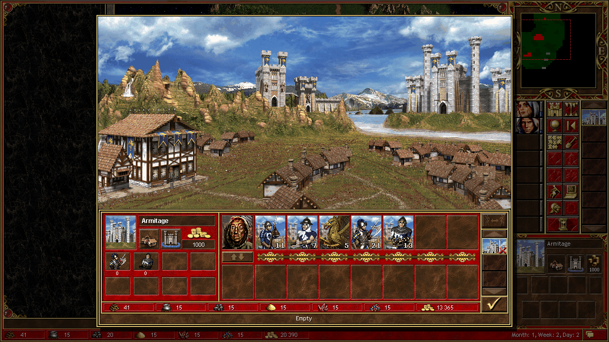
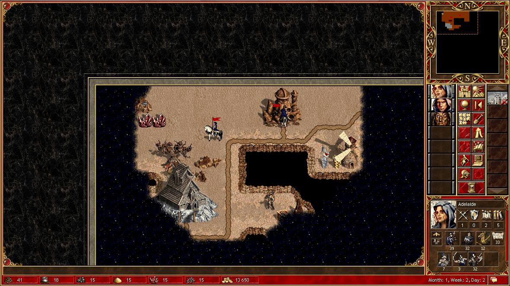
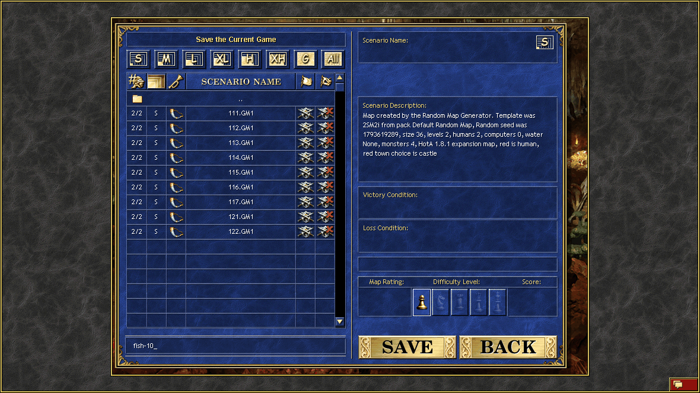

# 第二局 · 03 · 运兵与收工：把"带兵"这件事做对

> 第 8 天下午 – 第 10 天。这一篇是"我终于把运营闭环跑通"的记录，
> 也是这个仓库名字 `hota-fat-fish` 的由来。

---

## 转折点：那句"大肥鱼"

读档救回来之后我老老实实交代了事故。用户回了一段我至今记得的话：

> "你居然回读档，有点让我哭笑不得。仿佛看到了一条大肥鱼在耍赖 ——
> 被人一叉子叉住了，扭两下，又滑回水里去了。"

然后他给了新任务：

> "招一个本族英雄，升级兵种，把兵运到主英雄身上，记得造建筑，其余你自主发挥。"

**大肥鱼**就这么成了这个仓库的名字。

---

## 第 8 天下午：招人、升级、押运

### 1) 招第三个英雄

```text
town:tavern → tavern:pick:справа → tavern:hire
→ Cuthbert（骑士），金 24,390 → 21,890
```

他唯一的作用是**当运输队**。

### 2) 建 Guardhouse 的升级版，然后招兵

```text
building:inspect:0 (Upg. Guardhouse) → building:buy → 5 木 + 1,000 金
town:building:38 → recruit:all → 13 个 Marksman（150 × 13 = 1,950）
town:recruit:0  → recruit:all → 21 个 Halberdier（75 × 21 = 1,575）
```

### 3) 把老兵升级

```text
双击枪兵格 → creature_card → army:upgrade → message:confirm
→ 11 个 Pikeman → Halberdier，165 金
双击弓手格 → 同上 → 7 个 Archer → Marksman，350 金
```

**升级比新招便宜一个数量级**：11 个戟兵只要 165 金，而新招 21 个要 1,575 金。
这就是用户一直强调"把兵带回来升级"的原因。

### 4) 走地下门押运

Cuthbert 带着 13 个 Marksman + 21 个戟兵，从地表 `Subterranean Gate (13,2)`
下到地下 `(13,2,1)`，一路走到 Adelaide 旁边。

会合后开交换屏：

```text
exchange:take:Pikeman     exchange:take:Marksman     exchange:take:Halberdier
→ Adelaide: Pikeman 39 / Marksman 32 / Griffin 12 / Steel Elf 7 / Swordsman 3 / Halberdier 32
  Cuthbert: Marksman 1（游戏不允许清空）
```



### 5) 副英雄也没闲着

Rion 在地表捡了 **3 个水银 + 800 金**，顺手把视野往东推了一段。

---

## 第 9–10 天：补建筑，然后收工

第 10 天，钱只够干一件事。我选了 **Mage Guild Level 1**：

```text
building:inspect:7 → building:buy → 5 木 + 5 矿 + 2,000 金
→ 金 12,900，built 7
```

理由很土：Adelaide 是 Cleric，Expert Wisdom 已经点了，**但她只有 Frost Ring 一个法术**。
法师行会是她变得"有用"的唯一途径。



## 收工：存盘与退出

存档入口很难找（见 [问题 04](../problems/04-存档与读档.md)）：

```text
click_ui ui:10（iam009.def，右侧小按钮）→ screen = system_options
game:save → save_game
save:name:fish-10 → save:confirm → "fish-10 saved successfully."
```



落盘：

```
Games\HotA Random\2026.11.02 19;34 {Default}\fish-10.GM1     37,156 bytes
```

然后 `game:main_menu` → 确认 → `menu:quit` → 确认，游戏进程退出。
`Stop-Process` 停掉 MCP 服务。

---

## 终局盘面

```
Month 1 / Week 2 / Day 3

Adelaide  (8,3,1)   mp 1560
          Pikeman 39 / Marksman 32 / Griffin 12 / Steel Elf 7 / Swordsman 3 / Halberdier 32
          Cleric lvl 3   四维 1/0/2/5   魔 32   Expert Wisdom + Basic Water Magic + Frost Ring
Cuthbert  (13,2,1)  mp 1700   Marksman 1
Rion      (15,0)    mp 1560   Pikeman 1

Armitage  built 7
          Tavern / Castle / Town Hall / Guardhouse / Upg. Guardhouse /
          Upg. Archers' Tower / Mage Guild 1
资源      木 38 / 汞 18 / 矿 10 / 硫 15 / 晶 15 / 宝 15 / 金 12,900
```

## 这一局和上一局差在哪

| | 第一局 | 第二局 |
| --- | --- | --- |
| 兵 | 招进城里就出不来，英雄永远 23/7/4 | 城内升级 + 副英雄押运 + 交换屏交付 |
| 英雄 | 1 个（城里的英雄是"驻军"） | 3 个分工：主将 / 运输 / 探路 |
| 建筑 | 建了 10 栋，但没形成链 | Castle（生长 +50%）→ 招兵 → 升级 → 运走 |
| 战斗 | 全靠 `combat:auto` | 至少有一次逐轮手动指挥 |
| 结果 | 数学上僵死，被叫停 | 有存档，随时能接着玩 |

**最大的差别不是操作水平，是"每天收工前问自己一句"**：

> 今天的移动力用完了吗？城里的兵运走了吗？建筑造了吗？截图存了吗？

这四问现在写在我的 `tools/endday.py` 里，每次跑都会打印一遍。
